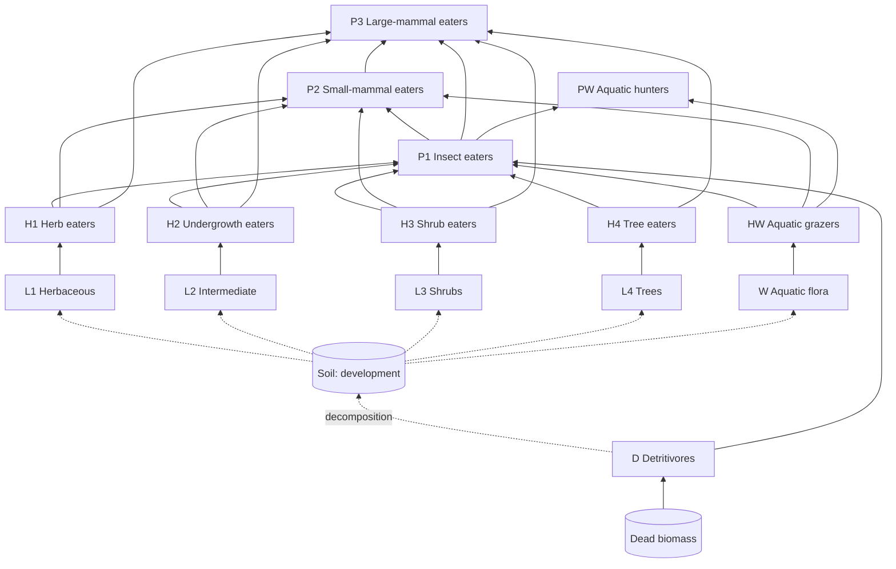

# gamerules.md — Gameplay vision and rules

> Companion to `INSTRUCTIONS.md`. This file defines **what the game is**; `INSTRUCTIONS.md` defines **how it is built**.
> Items tagged **[Proposed]** are design suggestions not yet validated by the author. Treat them as defaults that may change.
> Untagged rules are the author's decisions.
> All numeric values live in `data/balance.toml`; numbers in this file are illustrative only.
> Species data (§5–§6) also exists as machine-readable data in `data/species.toml`: one stat sheet per species (D-029). This file is the design reference.

---

## 1. Core loop

1. Players earn **biomass points**, from the thriving species in their ecosystems, plants + fauna.
2. They spend biomass on one of two things:
   - **unlocking** new species cards in the tech tree;
   - **spawning** species on the map.
3. Spawned species either **defend and grow the economy** (produce biomass, hold territory) or **attack** the opponent (consume enemy biomass), depending on the cell on which they spawn, and on whether their food belongs to the player or the opponent.
4. The ecosystem grows, conquers land, and outcompetes the opponent's ecosystem.

Victory conditions are defined in `INSTRUCTIONS.md` §2.3 (territory share or total biomass at the time limit), refined in §11.

### 1.1 V1 scope

- **Terrain:** a generated map with relief, a river, ponds and rock outcrops (§2.3, D-083); three bedrock types (D-240).
- **Start (author's decision, D-095):** the whole map is **bare soil** and nobody owns a cell. Each player starts with a biomass budget; the clock runs from the start, and a player's first planting, anywhere on land, is their **spawn point**: water, relief and rocks around it are a strategic choice. Only lichen & moss is unlocked at start (D-118; grasses cost 200, earthworms 250). Either pioneer can found a colony: lichen & moss spread at about 3/4 the pace of grasses (D-104).
- **Progression:** the landscape emerges through succession, **bare soil → meadow → increasingly developed shrub strata → forest**.
- **Out of V1:** wet meadow and the other biomes (§2.2); pollinators and fire (`INSTRUCTIONS.md` §2.5).
- **V1 species (author's table, D-087):** 15 plants in 5 families and 30 animals in 10 families, three tiers each (small, medium, large). See §4.2 and §5.
  - Every unit has at least one counter, except the apex predators, because of the food web relations.

---

## 2. The world

### 2.1 Hidden grid

- The map is backed by a **hidden grid**. The player **never sees cells**: everything is rendered as a fluid, continuous landscape.
- Each cell has an **owner** (none, player 1 or player 2) and can host several of its owner's species at once, in four vertical strata. Species of the same stratum **complement each other and interpenetrate** (e.g. grasses and wildflowers in one meadow cell), and each keeps spreading (D-022):

| Level | Stratum | Examples (V1) |
|---|---|---|
| L1 | Herbaceous | Lichen & moss, grasses, wildflowers; algae & water lilies |
| L2 | Intermediate (undergrowth) | Ferns, nettles, brambles; reeds |
| L3 | Shrub | Elder, hawthorn, hazel; cattails |
| L4 | Canopy (trees) | Oak, chestnut, beech |

Aquatic plants (family W) sit in the stratum of their height: they want the water through their moisture response, so they hold the shallows and wet banks (D-087).

- **[Proposed] Complementarity.** Species of one stratum compete with partial niche overlap (`niche_overlap` in `balance.toml`, below 1), so a mixed stand holds more biomass than a monoculture.
- A cell's **dominant level** is the highest level among the strata present in it, counting only strata whose biomass is above `establish_threshold`. It sets shade and succession; conquest uses strength (§3, D-225).
- **[Proposed] Shade.** Higher strata in a cell reduce the growth of the owner's lower strata in that same cell. Shade-tolerant species suffer less.
- **[Proposed] Succession (soil development).** Each cell has a **soil development** value (organic matter), which starts at 0 on bare soil. Plants raise it slowly, pioneers fastest: a lichen + grass cell alone takes about 28 min to reach full soil. Recyclers are the fast way: they turn litter and dead wood into soil (`soil_per_dead`), several times faster than the plants on a litter-rich cell (D-237). Each level needs a minimum value to establish: pioneers none, the rest of L1 low, L2 lower-medium, L3 medium, L4 high. This drives the V1 progression bare soil → meadow → shrubs → forest. It is independent of the soil *type* (§2.3).

### 2.2 Biomes [Post-V1]

**Not in V1**: V1 is one flat map on basic soil, where the landscape emerges through succession alone. Later, maps are built from three Western European ecosystems, shaped by the terrain modifiers of §2.3. Each is defined by the underlying water and nutrient fields. A species grows faster in its **affinity biome** and cannot establish where its soil or water requirement is not met.

| Biome | Field signature | Signature flora | Signature fauna |
|---|---|---|---|
| **Temperate deciduous forest** | High nutrients, medium water | Moss, ferns, understory plants, hazel, oak, beech, chestnut | Mycelium, bark beetles, wood mice, roe deer, wild boar, woodpecker, tawny owl, lynx |
| **Wet meadow** | High water, medium nutrients | Sphagnum, sedges & rushes, cattails, alder | Slugs & snails, voles, frogs & toads, grey heron |
| **Meadow & bocage** (hedgerow farmland) | Medium water and nutrients; lines of hedgerow cells | Grasses, wildflowers, nettle, bramble, elder, hawthorn & blackthorn, hedgerow oaks | Grasshoppers, pollinators, rabbits, hedgehog, buzzard, weasel, fox |

### 2.3 Terrain modifiers

**Built:** moisture per species (D-239) and the bedrock (D-240, below). Light modifiers equal 1.0.

**Terrain (author's decision, D-083, D-084):** every match has a generated map, the same for both players (180° symmetry):
- **Relief (D-096):** hills, plateaus and winding valleys, with cliffs (rock bands broken by passes) on the steep steps. It shapes moisture: valleys and banks are wet, hills dry. There is no movement penalty.
- **Map types (D-102):** each map draws a type: flat dry plains, meadows with ponds, hills with a river, rocky mountains, a canyon river, lakeland, marsh, or a central lake. The type sets how high and rugged the relief is, how much rock, and the water. Rivers follow the low ground; flooded lowlands make lakes and marshes along the topography.
  - **Shallows:** animals wade across (walkers at half speed). Land plants seep across slowly, through their water response (f_water).
  - **Deep pools** in the river and **deep pond centres:** no land plant grows there, and walkers cannot enter.
- **Rock outcrops** on the high ground: nothing grows there, and walkers cannot enter.
- **Animals** have a medium: walk (land and shallows), swim (water), amphibious (land and water), fly (anywhere). They find their way around what they cannot cross.
- **Territory:** rock and deep water are never owned, so borders stop at them.
- **Homes** are kept dry, flat and rock-free.

**Bedrock (D-240).** Every generated map has a bedrock of three rock types, in a few large patches (about 4 to 6, in mirrored pairs) that follow the land:

| Rock type | Where | Moisture | Favoured by (+15 % growth) |
|---|---|---|---|
| **Clay-limestone** (alkaline, calcium-rich) | Low ground, along rivers and lakes | By relief alone (about half wet) | Wildflowers, bramble, hawthorn, oak |
| **Schist-granite** (acidic, quick-draining) | High ground, around rock outcrops | Drier (−0.12) | Lichen & moss, ferns, elder, chestnut |
| **Silt-sand** (deep, water-retentive) | Broad flats: valley floors and plateaus | Wetter (+0.12) | Grasses, nettle, hazel, beech, aquatic plants |

- A plant on its favourite bedrock grows `bedrock_boost` (15 %) faster; elsewhere it grows normally.
- Flat maps (sandbox, tests) have no bedrock.
- **Read it:**
  - the Bedrock overlay (creamy yellow, dark grey, white);
  - the cell card's Moisture and Bedrock rows;
  - with a cell card open, the build bar's plant tiles keep their colour where they suit that cell (moisture and bedrock) and fade where they do not.

**Planned topography**, from an elevation field:
- **Water:** accumulates in valley bottoms (flow accumulation) and is scarce on ridges and hilltops.
- **Sunlight:** depends on slope orientation. South-facing slopes are sunnier, warmer and drier; north-facing slopes are shadier and cooler.

**Growth model** (to be enabled later):

```
growth_rate(species, cell) = base_rate(species)
                           × f_soil(species, soil_type)
                           × f_water(species, water)
                           × f_light(species, light)
                           × f_development(species, soil_development)
```

Each `f` is a species response curve (an optimum and a tolerance) defined in `data/species.toml` (D-029).

**Hooks to keep from V1 onward** (implemented in the M0 prototype, D-024):
- The simulation already stores the `soil_type`, `elevation`, `water` and `light` fields, with constant values.
- Species data already holds `soil_affinity`, `water_optimum`/`water_tolerance` and `light_optimum`/`light_tolerance`, with neutral defaults.
- Growth code already calls a single modifier function, which returns 1.0 in V1.

Adding terrain later is then new data and a map generator, not a rewrite of the rules.

---

## 3. Plant spread and competition

**Colonization gauge (D-024).** Every species has a gauge (0–100 %) in each cell. It caps the species' capacity there: `capacity = k_max × gauge`. The species is present from the first seeds, and biomass grows toward that capacity. The gauge rises with:
- **neighbourhood:** the cover of the same species, same owner, in the cell and its 4 neighbours;
- **soil:** soil development (a soft ramp up to each level's threshold) and, later, soil type;
- **bioclimate:** water and light, later from terrain.

It rises toward the site's **suitability**, so poor sites fill slower and cap lower. A species whose biomass dies out loses its gauge.

Plants reproduce and spread **from cell to cell**, into the 4 neighbouring cells. For each own cell whose species has enough biomass to spread (above `spread_threshold`), each neighbour is evaluated as follows:

**Strength and push (D-225, D-236).** Conquest of enemy land compares numbers, not plant levels:
- A cell's **strength** = vigor × layer × fertility × biodiversity (D-243; shade is gone):
  - **Vigor** = `vigor_floor` + (1 − `vigor_floor`) × the mean fill of the owner's layers that have a species above `establish_threshold`. A layer's fill is its species' summed cover, at most 1 (the cell card's layer bars). Each layer weighs its species' spread rate × cover, so fast spreaders count most and young layers little.
  - **Layer** = `layer_mult` of the cell's highest established layer (L1 1.0, L2 1.15, L3 1.3, L4 1.5).
  - **Fertility** = 1 + `fert_gain` × soil development (0 to 1).
  - **Biodiversity** = 1 + `div_gain` (0.5) × species (the owner's plant species established in it + its animal species living in it), at most `div_cap` (4). Two L1 species half grown beat one L1 fully grown. (Income has its own pair, §7.)
- The **push** on a cell = the sum of the strengths of its enemy neighbours (4 sides). Push comes from the plants spreading; animals add to it only as part of their own cell's strength. An enemy animal standing in the cell adds nothing (animals attack by grazing, §6.1).

| Neighbour cell state | Result |
|---|---|
| **Empty** (bare soil) | Gradually colonized. A claim progress builds up at `spread_rate × neighbour pressure × suitability`, and the cell switches to the spreading player when progress is complete. The arriving species start established, with a gauge equal to pressure × suitability. Species with zero suitability cannot arrive. A former owner under a lockout cannot claim it (§6.1) |
| **Owned by the opponent, push > strength** | Gradually **smothered**: each of the enemy's plant species there loses `smother_rate × (push − strength)`. When the enemy biomass reaches zero, the cell switches to us, with our species established in the neighbours (any level) |
| **Owned by the opponent, push ≤ strength** | **Nothing happens.** The frontier holds, until either side's numbers change |
| **Owned by us** (D-024) | Each of our species colonizes the neighbour through its gauge: forest advances over our own meadow, and lower strata fill in underneath (understory), subject to soil and bioclimate. Strata no longer shade each other (D-243). Only species established in a neighbour (above `establish_threshold`) seed new arrivals |

**Conquest hold (D-230).** A cell just conquered is held against its former owner for `hold_s` (20 s): that player's push has no effect on it until the hold runs out. A freshly taken cell has its species at the establish threshold and would otherwise flip back and forth; the hold gives it time to grow, and the front moves in steps instead of flickering. Grazing still works on it.

**Contested empty cell.** When both players are colonizing the same empty cell, the first to complete progress takes it. If both complete on the same tick, the cell stays empty.

**Determinism note.** Spread is computed from the previous tick's state (double buffering), so the result never depends on the order in which cells are updated.

### 3.1 Design consequences

- **A front holds only while both sides are equal.** Any change moves it: growth, a new species, fertile soil, dead trees, weather, a raid. Ways to push:
  1. **Depth:** more species per cell, and higher layers (tall play).
  2. **Geometry:** a cell touching 2 or 3 of your cells takes all their strengths. A bulge into your land is pushed back at its tip, and encirclement wins (wide play).
  3. **Grazing:** herbivores thin an enemy cell's layers, which lowers its vigor, eat species out of it, or eat it bare, which opens it to your spread (rush play).
  4. **Fertility:** recyclers and litter raise soil development, which multiplies strength.
- **Monocultures are weak.** A full beech wall alone has strength 1.5 × 1.6 = 2.4 per cell; a mixed cell of four species on lower layers beats it.

### 3.2 Territory demarcation line

A continuous **demarcation line** is drawn wherever cell ownership changes, so that control of space is always readable.

- **Look:** organic, never jagged along cell edges. It is extracted as a contour (marching squares) from a smoothed ownership field, drawn in player colours with a soft glow.
- **States:**

| State | Display |
|---|---|
| Stable frontier (same level, frozen) | Solid line |
| Active front (colonization or smothering in progress) | Pulsing line, with the pressure direction shown (e.g. flowing particles toward the losing side) |
| Border with empty (neutral) land | Thinner, dashed line |

- The same line appears on the **minimap**. The HUD shows each player's **territory %** and the current victory threshold (§11.3).
- **[Proposed]** A toggle key (`T`) shows or hides the line; it is on by default.
- The line is computed by the **renderer** from snapshots. It is not part of the simulation state, which keeps determinism.

---

## 4. Tech tree

### 4.1 Principles

- The tree goes from the **simplest species to the most complex**, with **flora and fauna in the same tree**.
- The tree is organised in **families** (D-087): 5 plant families and 11 animal families, each with three **tiers** (small, medium, large), one species per tier. Unlocking a card costs biomass.
- Unlocking a card does **not** place anything on the map. It only makes the species available to spawn.
- Unlocks are permanent: a card stays unlocked even if the species dies out on the player's side.
- **Unlock requirements:** the previous tier of the same family, plus, for an animal, one of its habitat plants. For example, the wolf needs the lynx and a tree.
- **Spawning** additionally requires the species' **spawn conditions** (§6.3) to be met at that moment.

### 4.2 Families and tiers (author's table, D-087)

| Family | Small (tier 1) | Medium (tier 2) | Large (tier 3) |
|---|---|---|---|
| **L1** Herbaceous | Lichens & mosses | Grasses | Wildflowers |
| **L2** Intermediate | Ferns | Nettles | Brambles |
| **L3** Shrubs | Elder | Hawthorn | Hazel |
| **L4** Trees | Oak | Chestnut | Beech |
| **W** Aquatic flora | Algae & water lilies | Reeds | Willow |
| **D** Recyclers | Earthworms | Fungi (mycelium) | Black woodpecker |
| **H1** Herbaceous eaters | Grasshoppers | Rabbit | European bison |
| **H2** Intermediate eaters | Slugs & snails | Bank vole | Roe deer |
| **H3** Shrub eaters | Caterpillars | Red squirrel | Red deer |
| **H4** Tree eaters | Bark beetles | Eurasian beaver | Wild boar |
| **HW** Aquatic grazers | Larvae (become dragonflies) | Roach (fish) | Mallard duck |
| **P1** Insect eaters | Great tit | Common frog | Badger |
| **P2** Small-mammal eaters | Weasel | Red fox | Pine marten |
| **P3** Large-mammal eaters | Eurasian lynx | Wolf | Brown bear |
| **PW** Aquatic hunters | Pike | Grey heron | Eurasian otter |
| **S** Superpredators (D-187, D-197) | Hawk (kestrel, hobby, sparrowhawk) | Wildcat | Eurasian eagle-owl |

### 4.3 Diets, habitats and media [Proposed defaults, D-087]

- **Grazers by role (D-244):** a grazer eats every plant of its family's layer (H1 every L1 plant, H2 every L2, H3 every L3, H4 every L4, HW every aquatic plant), all at the full diet yield, and lives on that layer (its habitat). Its tier multiplies the damage it does to enemy plants (`[fauna] tier_damage`: 1, 2, 3). The diet rules below now apply to hunters and recyclers only.
- **Diets (D-122, D-123, D-126):** each animal has a primary and a secondary food, and a tier 3 animal a tertiary one, listed in that order in `data/species.toml`. Low tiers are easy to counter (D-126): within each plant layer, the tier-1 insect eats the tier-1 plant first, then the tier-2 one; the tier-2 animal the tier-2 plant, then the tier-1; the tier-3 animal the tier-3 plant, then the tier-2, then a neighbouring layer. Every tier-1 plant has at least two eaters, one of them a tier-1 insect; tier-3 plants have one or two. Grazer families feed on their own plant layer first (H1 meadow, H2 undergrowth, H3 shrubs, H4 canopy, HW water), then a neighbouring one; hunter families target an animal size (P1 insects, P2 small mammals, P3 large game, PW water life). Every plant and every animal is food for someone. Recyclers eat dead biomass.
- **Food ranks (D-123):** an animal seeks its primary food in sight first, then the secondary, then the tertiary (an attack-move looks on enemy land the same way). A grazer eats the best-ranked plant in its cell, a hunter the best-ranked prey in reach. A meal gives energy × `[fauna] diet_yield` of its rank: 100 %, 75 %, 50 %.
- **Habitats:** grazers need their food plants on their owner's land; hunters need a plant family (woods for the lynx, water plants for the pike). Tier-1 insects live one layer below their food (D-126): grasshoppers and slugs on herbs, caterpillars on undergrowth, bark beetles on shrubs, so they can counter a layer before you grow it.
- **Media (D-084):** fish and larvae swim; frog, beaver, otter, mallard and heron are amphibious; great tit, hawk, eagle-owl and black woodpecker fly; the rest walk.
- **Black woodpecker (D-092, D-127):** eats standing dead wood first (then litter), so it clears dead trees fastest (§6.2, D-227).
- **Great tits (D-141)** also eat grasshoppers: a tier-1 answer to grasshopper swarms.
- **Food-web harmony (D-187):** counters cost about what the raids they answer cost, and tier-1 hunters live on meadows, so defence comes in the same phase as attack.
  - **Tiers:** within a family, no tier is weaker than the one below (costs, yield, body).
  - **Eaters fall with tier and cost:**

    | Species | Eaten by |
    |---|---|
    | Tier-1 grazers and insects | 2–3 species |
    | Tier-2 grazers | 2 |
    | Tier-3 grazers | 1–2 |
    | Tier-1 hunters | 2–3 |
    | Tier-2 hunters | 1–2 |
    | Apex hunters (unlock 6 000 or more) | 0–1 |

    Plants follow the same rule: tier-1 and tier-2 plants are eaten by 2–3 grazers, tier-3 plants by 1–2.
  - **Superpredators (S, D-197):** they eat the hunters below them, so a defence can be answered: the hawk eats tits, the wildcat eats weasels and hawks, the eagle-owl eats foxes, hawks and herons.
  - **Guard test:** `sim-core/tests/food_web.rs` checks the tier rule and the eater counts.
- **Swarms (D-065):** earthworms, fungi, grasshoppers, slugs & snails, caterpillars, bark beetles and larvae are drawn as swarms, not units. They take orders like units (D-238): select a swarm from the unit list or its strategic icon, then move or attack-move it; clicking or dragging over the map picks units only.
- **Movement (author's direction, D-088):** insects keep a Brownian flutter; small herbivores are calm and slow and graze stop-and-go; large herbivores move slowly and steadily; hunters are fast when they hunt and calm when idle; birds drift lightly.

### 4.4 Costs [Proposed]

- Every species has its own stat sheet in `data/species.toml` (D-029): **growth** (plants: colonization gauge speed; animals: seconds between births), **spawn cost**, **unlock cost**, **yield** (points per second per covered cell or per animal; stat-sheet seconds are ecology seconds, which run at `pace` per real second, D-069), **population cap** (plants: a share of the map's cells per player, D-045, which limits planting and expansion into free land, not conquest: flipping enemy cells or retaking land grazed bare from the enemy, D-113; animals: a head count per player) and a **special effect**.
- Unlocking is per species: it needs one unlocked species on the previous tier of its family and, for an animal, one of its habitat plants. Species with unlock cost 0 are available at start.
- The initial unlock costs follow the placeholder rule `base(level) × 1.5^(tier−1)`; spawn costs scale with level and body size.
- Higher tiers are not strictly better. They trade off speed vs. efficiency, or shade tolerance vs. growth rate.

---

## 5. Food web design (Western European ecosystems)

### 5.1 Flora and 5.2 Fauna

The species, their stats, diets, habitats and media are in `data/species.toml` (D-029, D-087), one stat sheet each; §4.2 and §4.3 give the design. The stats are placeholders for the balance runs (M7).

### 5.3 Food web overview (trophic groups)

Arrows show energy flow (food → consumer). Dotted arrows are support interactions.



All dead organisms, plants and animals, feed `Dead biomass`.

---

## 6. Fauna rules

### 6.1 Feeding on cells (herbivores)

- Animals attack by **feeding on cells**, and **only where species matching their diet are present**. For example, caterpillars can only feed on cells holding shrubs or trees.
- A feeding herbivore reduces the biomass of the matching enemy stratum in its cell. When a stratum reaches zero it disappears, which lowers the cell's strength (§3) or empties the cell.
- **Grazed bare (author's decision, D-098, D-225):** a cell whose plants are all eaten by the enemy's grazers becomes bare soil: neutral, owned by nobody. A time lock stops its former owner from reclaiming it directly for `lockout_s` (30 s); anyone else may claim it, so the raider's plants can move in behind its grazers. The lockout is the main lever of rush against wide.
- Grazing never pushes a cell by itself: it weakens it, by eating species out of it (lower strength, §3) or eating it bare.
- **[Proposed] Seed eaters** (voles, when feeding on hazel or trees) do not reduce standing biomass. Instead, they reduce the enemy tree or shrub's **spread rate** around them.

### 6.2 Feeding on agents (predators)

- Predators attack enemy agents whose species is in their diet. Damage reduces health, and a killed agent becomes dead biomass.
- **Home hunting (D-218):** with no enemy prey in reach, a hungry predator takes its owner's own prey of its diet, at `own_catch`, only from the surplus, species by species (prey switching, D-263): an own prey species is fair game while it numbers, in the hunter's sight, `own_surplus` × `prey_per_predator` per own hunter of the hunter's species (D-222: 1.25 × 3). A hunter fed by a plentiful prey leaves a scarce one alone. A species a hunter eats never counts as its competitor for food (D-263). Births only need `prey_per_predator`, so hunters breed past what home prey can feed, then starve back: the levels cycle. Each player thus keeps a food pyramid at home (about 32 plant cells : 16 grazers : 4 hunters : 1–2 superpredators) that cycles without crashing. Enemy prey always comes first, sated or not.
- **Meals (D-218):** a kill restores `kill_meal` of the hunter's body (by diet rank), whatever the prey's size.
- Predators cannot attack species outside their diet. A fox ignores slugs, for example.
- **Refuge (D-023):** a player's small fauna inside own cells with dense hawthorn & blackthorn or bramble, or in the water dense cattails (D-125), cannot be hunted. Predators are otherwise kept in check by their own predators (§5.2).
- **Dead trees (D-127, D-227):** a cell's tree stand dies:
  - of old age, at a base rate (`natural_death_s`, a mean life of 2 h of ecology time; D-152, D-237);
  - or by a catastrophe or weather: processionary caterpillars, the violent storm (windthrow), drought.

  A dead tree model replaces the living one and stays until the dead wood is gone: it rots away slowly (`rot_s`), and recyclers clear it faster, the black woodpecker best of all (dead wood is its primary food).
  - **While it stands, the cell is locked to its former owner's trees only** (the player who owned the cell when the stand died). The former owner's herbs, undergrowth and shrubs still grow there.
  - **The enemy's trees may grow there.** The dead stand takes its tree species out of the cell's strength (§3), so the enemy push often wins the cell; the enemy's trees then arrive like any of its species. A cell left with dead wood only is neutral bare soil, open to the enemy's trees but not to the former owner's.
  - Goal: dead trees break frozen fronts. Recyclers are the defender's answer: they clear the dead wood sooner, and as resident animals they add to the cell's strength.

### 6.3 Spawn conditions: dens (D-245)

A species can be bought when **all** of the following hold:
1. Its card is unlocked (§4).
2. Its **habitat** holds on the player's land and its population is under its carrying capacity (§6.4).
3. The player has a **den** for its medium:
   - **Land den:** the player's first planted cell (the spawn, D-095). Walkers, amphibious animals, fliers and recyclers appear there.
   - **Water den:** the player's first own cell where an aquatic plant takes. Swimmers appear there.
   - **The land den is the player's heart (D-251):** it never moves, and a player whose den cell is not theirs any more (taken, grazed bare, poisoned) loses the match at once, like a MOBA ancient. Both on one tick: a draw. The water den moves to the nearest own cell with an aquatic plant.
   - The den shows as a burrow (a stick lodge for the water den), visible to the enemy once in sight.
   - **Move den (D-253):** a player may move the land den to an own grown land cell (the cell card's button), paying `den_move_cost` (2000). The new burrow is built over `den_build_s` (20 s); until then both cells are dens, and losing either loses the match. One move at a time.

Every bought animal appears at its den, at the base price, wherever the player clicks: there are no remote drops. Raids walk across the front, and a defence needs hunters living near it or sent in time.

### 6.4 Energy, upkeep and reproduction

- **Reproduction (D-023):** an animal whose energy crosses a threshold reproduces, which costs energy, under its species' carrying capacity. Cards found populations (small groups); breeding grows them (D-246).
- **Carrying capacity by habitat (D-246):** a species' population cap = `per_cell` × the player's own cells holding its habitat (e.g. 5 rabbits per own L1 cell). Buying and births stop at the cap; a population above it (habitat lost) stops breeding and starves back. `[agents] max_agents` stays the global ceiling.
- **Spreading (D-246):** an idle animal with no orders, in a cell crowded past `per_cell` of its species or out of food, moves to the nearest own habitat cell with food and room. Herds thin out over their habitat by themselves.
- **Hold (D-246):** the hold order (H + click) gathers the selected animals on a cell and keeps them there: they don't spread, wander or flee, and they eat or strike within reach. Any other order or Stop releases them.
- **Carrying capacity (author's decision, D-066):** a birth also needs food nearby. Within the animal's sight, the food must cover every animal of the same role with an overlapping diet, plus the newborn:
  - grazers and decomposers: `food_reserve` seconds of bites each, from their diet plants (any land) or the litter, shared with the other player's animals that eat the same;
  - predators: `prey_per_predator` huntable prey each (own and enemy; superpredators `prey_per_superpredator`), counted over their owner's predators (D-218).
  - The habitat cap above bounds every species; the per-player cap is a safety ceiling. Populations then rise and fall with their food: prey with the plants, predators with the prey, in the manner of Lotka–Volterra cycles.
- **Hunting (D-066, D-218):** a predator with huntable enemy prey within `strike_radius` cells kills one per flora tick with chance `catch_chance`; own prey only when hungry (below full energy) and from the surplus, with chance `own_catch`.
- **Grazing at home (D-066, D-247):** herbivores bite their owner's plants at `own_graze` of a full bite, but gain the energy of a full bite, and only where that plant's cover is at least `own_graze_min` (50 %); they never bite it below. Cropping a full meadow puts it back in its productive phase (§7).
- **Raids (D-160):** an attack order holds until the area around its goal is bare: the raiders graze every enemy plant they eat in sight, and only then go free. A move order ends on arrival.
- **Trampling (D-152):** on enemy land, plants lose `graze_damage` (4) times what a grazer eats; the extra is trampled to litter. Raids break fronts faster, but the raiders are not fed more.
- Every animal has an energy value. It regains energy by eating and loses it over time. At zero energy it dies and becomes dead biomass.
- **Trophic transfer:** eating converts ~10 % of the consumed biomass into the eater's energy, and ~10 % into biomass points for its owner. This follows the ecological 10 % rule and keeps consumer armies expensive.

---

## 7. Biomass economy

- **Biomass points** are the single currency.
- **Income from production (D-247):** a plant's income per cell = yield × (`stock_share` × cover + (1 − `stock_share`) × production), where production is the species' gross growth in the cell over its peak logistic growth (r·K/4). A mature cell earns its turnover only (about 0.6 of a growing one); a regrowing or freshly taken cell earns the most. Holding a forest gives strength, turning land over gives income.
- **Spending:** unlocking cards (§4) or spawning species (§8).
- Animals yield `yield` each per second (D-027, D-029).
- **Biodiversity bonus (D-225):** a cell's plant income × (1 + `div_gain` × its species count, the same count as its strength in §3), capped at `div_cap`. Costs are per species (§4.4).

---

## 8. Spawning

- **Flora** is seeded into an area (a brush or circle) on own territory or on its border. It then spreads according to §3.
- **Trees** are placed individually and act as territory anchors.
- **Fauna** appears at its den (§6.3), as a small founding group.

---

## 9. Units and control

### 9.1 Autonomous agents, RTS control

- Fauna units are **autonomous agents**. Without orders they forage within their diet, flee their predators and follow their species' behaviour.
- The player can **select** them, individually or as a group, and give **RTS orders** that override their autonomy until the order is completed.
- Plants are not directly controllable. The player shapes them through seeding and spatial choices.

### 9.2 Default controls

| Input | Action |
|---|---|
| Left click / drag | Select unit(s) |
| Right click on ground | Move to location |
| Right click on enemy target (valid for the unit's diet) | Attack / feed on target |
| `A` + left click | Attack-move: move and feed on any valid target on the way |
| `S` | Stop, return to autonomous behaviour |
| `H` + left click | Hold: gather on that cell and stay (D-246) |
| `Ctrl` or `Shift` + number / number | Assign / recall control group (in the browser, Chrome keeps `Ctrl` + 1–8 for its tabs; D-053) |

---

## 10. Offense and defense — the key gameplay tension

| Posture | What it does | Examples |
|---|---|---|
| **Defensive / economic** | Generates biomass, holds and grows territory, protects its own ecosystem | Plants producing biomass; predators spawned to eat enemy herbivores in your territory; earthworms raising soil development |
| **Offensive** | Enters enemy territory to destroy their biomass and weaken their economy | Caterpillars eating enemy plants; rabbits and caterpillars breaking an enemy shrub frontier; predators ordered to hunt enemy prey in enemy territory |

- The core decision at every moment: **invest in growth (defense and economy) or strike the opponent (offense)**.
- Animals appear at their den (D-245) and walk: raids cross the front, defenders are hunters living near it or sent in time.
- **[Proposed] Stance per consumer:** Offensive (seek targets in enemy territory) or Guard (stay on own territory and intercept intruders).
- **Friendly fire:** herbivores without orders may graze your own plants if no enemy flora is nearby, but with a way slower rate, and they generate bonus biomass, the idea is to use them as economy.

**Three styles, one goal (D-225).** Map control is the only victory condition. Three play styles come out of the strength rule (§3) and are mixed freely; none is a set route:
- **Tall:** spend on unlocks rather than spread; stack species and fertility per cell for strong, high-income cells; roll over the enemy late.
- **Wide:** grab land with cheap low plants; surround the opponent's bulges; many cheap cells soak up raids.
- **Rush:** breed grazers and walk them in, opened by cheap blights (§10b), to eat species out of enemy cells or eat them bare (§6.1).

Intended cycle, tuned with the bench (not hard-coded): rush beats tall (its value is concentrated), wide beats rush (its value is spread), tall beats wide (late strength), unless wide encircles it or the clock runs out first. Measured (D-229, bots at medium): rush > tall 71 %, tall > wide 46 %, wide > rush 53 %: the cycle is not there yet.

---

## 10b. Catastrophe cards (D-129, D-248, D-252)

Cards at the far right of the build bar: no unlock, paid at each use, then cooling down before the same player may play them again. Each card opens at a match time (`available_s`): cheap small ones from the start, the big ones later. They hit **everything** in their disc, both players' plants alike, so aiming matters. Values in `data/balance.toml` `[catastrophes.*]`.

Nine cards in a 3×3 grid (D-252): columns by what they hit, rows by price, size and opening time.

| | Herbs (L1–L2) | Woody (L3–L4) | Fauna |
|---|---|---|---|
| **Cheap**, from 0 min | Aphid outbreak: r2, herbs lose half their biomass · 600 · 90 s | Processionary caterpillars: r2, trees die standing (D-127) · 1200 · 120 s | Poisoned bait: r1, every animal dies, swarms too · 800 · 120 s |
| **Mid**, from 5–10 min | Late frost: r3, herbs lose 70 % · 2500 · 150 s | Chainsaw: r3, every shrub and tree felled to litter · 5000 · 240 s | Hunters: r3, every non-swarm animal shot · 5000 · 240 s |
| **Large**, from 15–20 min | Chemical spill: r4, back to bare soil, nobody's · 10000 · 300 s | Violent storm: r9, shrubs felled, trees windthrown here and there · 22000 · 420 s | Epidemic: r8, about half of the animals die · 15000 · 420 s |

## 10c. Weather (D-132)

Random weather events hit the whole map, both players alike. There is one per half hour, sometimes two: the first starts 8 to 15 min in, the next 12 to 20 min after one ends. A **weather alert** comes 30 s before each (a toast and the badge under the clock), so players can prepare. Values in `data/balance.toml` `[weather]`. Seasons are not in V1.

| Weather | Lasts | Plants | Animals | Also |
|---|---|---|---|---|
| Rain | 2.5 min | growth +15 % | speed −10 % | |
| Drought | 2.5 min | growth −60 % | speed −10 %, bites −15 % | about 12 % of tree stands die standing (dead trees, §6); about 20 % of grass-only cells dry up to bare soil |
| Flood | 2 min | growth −15 % | speed −15 % | land cells next to water flood (60 % each) and turn to shallows until it ends; land plants there drown to litter. Only on maps with water |

## 10d. Fog of war (D-249)

Each player sees only around their own land and animals. An own cell reveals a radius set by its highest established layer (`[fog] layer_sight`: L1 2, L2 3, L3 4, L4 5 cells; a bare own cell 2; round discs, r² + r); an animal reveals its species' `vision` (D-255), separate from its food-search `sight`: insects 1–2 cells, small animals 2–3, large grazers and canids 4–7, felids 9–10, birds of prey 11–12; fish see the water only. Out of sight, the enemy's animals are hidden and its plants and frontier show their last seen state. The territory bar stays global (it is the score). Fog is display and bot input only: lockstep peers still hold the full state. Off in Sandbox and replays.

## 11. Game phases, endgame and anti-stalemate

### 11.1 Phases (V1; written for 20 minutes, the match now lasts up to 60, D-094)

| Phase | Time (indicative) | Dominant layer | What matters |
|---|---|---|---|
| **Early** | 0–5 min | Pioneers, grasses | Race for empty land, soil development, first income |
| **Mid** | 5–12 min | Shrubs, first fauna | Frontiers form; herbivore raids and predator drops decide local fights |
| **Late** | 12–20 min | Forest | L3 frontiers tend to freeze; forest dynamics, pests and disturbances decide the match |

### 11.2 Why stalemates happen

- Under the old level rule, same-level frontiers froze. The strength rule (D-225) removed that: a front only holds while both sides are equal (§3.1).
- A leading player could still turtle and wait for the time limit.

The mechanics below make sure **no position is permanently locked**, and that **the trailing player always has tools to swing the game**.

### 11.3 Anti-stalemate mechanics

1. **Forest gap dynamics (senescence).** Tree stands die at a base rate (old age), or by catastrophe and drought (§6.2, D-227). The dead tree stands on, the cell loses its tree species (strength, §3), and a **gap** opens. The former owner's trees are locked out of it until the dead wood is gone; the enemy's are not. Forests stay alive, as real forests do.
2. **Monoculture vulnerability.** Pests (caterpillars, and the processionary caterpillars card) deal extra damage in cells whose neighbourhood is dominated by a single species. Mixed stands get a resilience bonus. This punishes "walls of beech" and rewards diversity.
3. **Keystone disturbance cards (top of the tech tree).** They are expensive, have a long cooldown, and are **telegraphed**: the opponent sees a warning a few seconds before they hit.
   - *Processionary caterpillars:* targeted area; the trees there are weakened and lose biomass over time.
   - *Storm:* windthrow along a corridor, opening a line of gaps through a forest.
   - *Forest fire* **[Post-V1]**: ignites a target area. Each tick, fire spreads to neighbouring cells with a chance (seeded RNG) that grows with the cell's biomass. Burnt strata become dead biomass and the soil gains nutrients. Fire dies out on bare or low-biomass cells, so meadow strips act as firebreaks. It opens irregular gaps through a forest.
4. **Decaying territory threshold (adopted, D-143).** The territorial victory threshold holds 80 % until 20 min, then decreases linearly to 50 % at 35 min (D-147, D-148, D-265): by then the larger side wins. This rewards whoever leads and ends matches in about 25–30 min.
5. **Guaranteed end.** At the time limit, the highest standing biomass (living flora + fauna) wins; if tied, the higher territory share wins; if still tied, the match is a draw.

### 11.4 Comeback levers for the trailing player

- **Asymmetric raids:** herbivores cost much less than the biomass they can destroy. For example, a caterpillar swarm is cheaper than the oak cells it can defoliate.
- **Predator drops:** a well-placed predator can wipe out an enemy raid instantly.
- **Disturbance cards:** they target the leader's biggest asset, the forest.
- **Fast pioneers:** gaps and bare cells can be retaken quickly with cheap species.

### 11.5 Stalemate metric (balancing)

`tools/balance` tracks **frontier mobility**: the territory changing hands per minute. Target: fewer than 5 % of simulated matches reach the time limit with under 2 % territory change over the last 5 minutes.

---

## 12. Open questions

1. ~~**Tier in spread:** should the tier matter within a level?~~ Moot since D-225: levels are no longer compared.
2. **Contested empty cells:** is the proposed resolution acceptable (§3)?
3. **Predator drops in enemy territory:** allowed with a surcharge, or own territory only?
4. **Herbivore trigger range `R`:** a global rule, or per species?
5. **Stance:** fixed role per species, or a switchable stance per consumer?
6. **Starting conditions:** starting budget and starting unlocks (default proposed in §1.1).

Resolved (see `memory/DECISIONS.md` D-017, D-022): three flora levels, with pioneers as L1 tier 1; bees and fire are post-V1; the hedgehog counters slugs; decomposers are agents; unlocks are permanent; species of one stratum interpenetrate.
